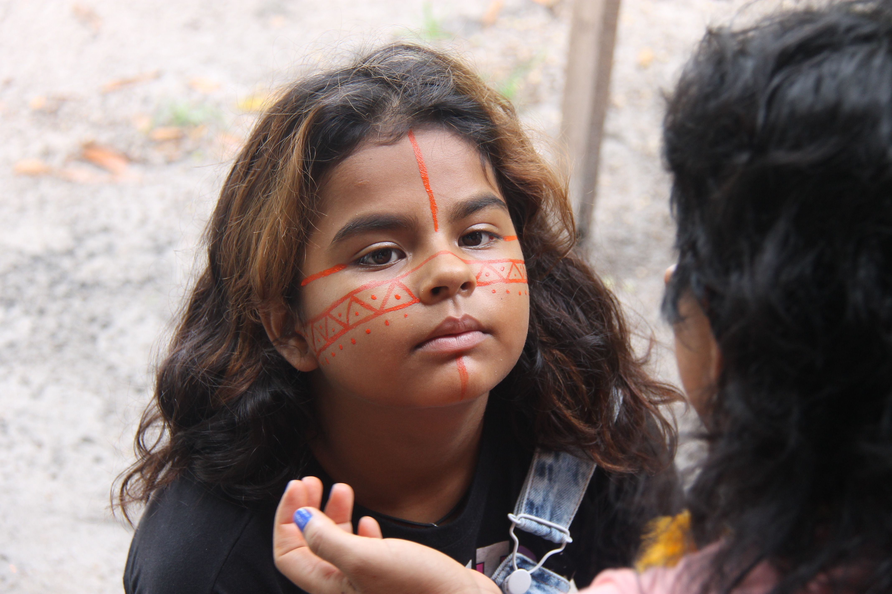

# Vozes do Saber

Site demonstrativo de apoio à trajetória educacional de estudantes indígenas, da educação básica ao ensino superior. A proposta reúne materiais de estudo e pedidos de apoio acompanhados por escolas, faculdades ou equipes parceiras.

**Acesse o site:** [Vozes do Saber no GitHub Pages](https://bfvvh.github.io/apoio-educacao-indigena/)

## Páginas

- **Início:** apresenta o projeto e os caminhos principais.
- **Sobre e Instituições parceiras:** explicam a proposta e o papel das escolas, faculdades e equipes parceiras.
- **Materiais:** traz atividades da educação básica e uma orientação de estudo para o ensino superior.
- **Pedir apoio:** registra um pedido e permite consultá-lo pelo protocolo.
- **Pedidos recebidos:** permite ver, responder e atualizar pedidos.
- **FAQ, Integrantes e Contato:** reúnem dúvidas, equipe e links úteis.

## Como abrir e testar

Abra `index.html` com o Live Server do VS Code ou outro servidor local. Para testar o fluxo:

1. Acesse **Pedir apoio**, preencha o formulário e copie o protocolo.
2. Abra **Pedidos recebidos** pelo link no fim da página de pedidos.
3. Escolha o protocolo, altere o status e escreva uma resposta.
4. Volte à consulta do pedido e use o protocolo para ver a atualização.

Os pedidos ficam no `localStorage` do navegador.

## Tecnologias e arquivos

O projeto usa HTML, CSS e JavaScript, sem dependências externas. As páginas estão em `paginas/`, os estilos em `css/style.css`, as interações em `js/script.js` e as imagens e ícones em `assets/`.

## Integrantes

- Felipe Rocha Sanches — RM576191, 1TDSPA — [GitHub](https://github.com/FeRocha14) · [LinkedIn](https://www.linkedin.com/in/felipe-rocha-a46196248/)
- Breno Menezes de Macedo — RM574875, 1TDSPA — [GitHub](https://github.com/BrenoMenezes20) · [LinkedIn](https://www.linkedin.com/in/breno-menezes--/)
- Victor Henrique Lima Andrade — RM575563, 1TDSPA — [GitHub](https://github.com/Victor0Henrique) · [LinkedIn](https://www.linkedin.com/in/victor-henrique-a4996642a/)
- Victor Sales Marques — RM574418, 1TDSPA — [GitHub](https://github.com/victor-singrax) · [LinkedIn](https://www.linkedin.com/in/victor-sales-marques/)

## Imagem do projeto

## Repositório e contato

- [Código no GitHub](https://github.com/BFVVH/apoio-educacao-indigena)
- [Página de contato](paginas/contato.html)

## Créditos das imagens

A foto da página inicial é de [Alisson Soares / Pexels](https://www.pexels.com/pt-br/foto/menina-garota-moca-festival-14969148/) e foi usada conforme a [licença do Pexels](https://www.pexels.com/license/). Ela é ilustrativa; a pessoa retratada não está vinculada ao projeto.

A foto da página Materiais é de [Ambam Gorilla / Pexels](https://www.pexels.com/pt-br/foto/pessoa-selecionando-um-livro-de-uma-prateleira-interna-29031732/) e foi usada conforme a mesma licença.

A foto da página Instituições parceiras é de [An Tran / Pexels](https://www.pexels.com/pt-br/foto/livros-caderno-notebook-mesa-12561284/) e foi usada conforme a mesma licença.

